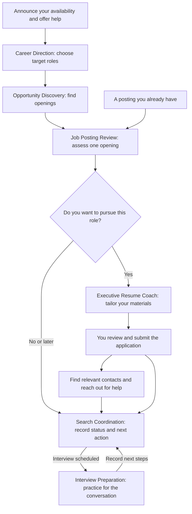

# Workflow Guide

Choose the skill by the output you need. Do not run both platform alternatives on the same task unless you want a comparison.

## Job search workflow

First, announce your availability and offer help to others. After you submit an application, look for contacts who could help with that particular role.

**Job Alert to Application** coordinates discovery, review, materials, and tracking when you start with a batch of alerts. Ask it to stop after the stage you need. You can also use **Interview Preparation** at any time to build a story bank.

| Number | Need | ChatGPT owner | Claude route | Example request |
| --- | --- | --- | --- | --- |
| 1 | Announce availability and offer help | job-search-announcement | job-search-announcement | Draft a public job-search announcement using my approved facts and chosen assistance. |
| 2 | Choose targets | career-direction | resume coach for role-family alignment | Compare credible target lanes using my evidence. |
| 3 | Find openings | opportunity-discovery | Discovery stage of job-alert-to-application | Check these companies and retain closed or unreadable listings. |
| 4 | Decide fit | job-posting-review | job-posting-review | Assess this full posting against my profile and resume. |
| 5 | Prepare materials | executive-resume-coach | resume coach; alert workflow for cover letters | Tailor my resume and cover letter using only supplied facts. |
| 6 | Track applications | search-coordination | Tracker stage of alert workflow | Record my interview date and next action. |
| 7 | Find contacts after applying | job-connection-outreach | Use the same standalone instructions | I applied for this role. Who could introduce me to the hiring team? |
| 8 | Prepare interviews | interview-preparation | No dedicated packaged equivalent | Build a reusable story from this accomplishment. |
| 9 | Run the sequence | job-alert-to-application | job-alert-to-application | Review these alerts, prepare materials for suitable roles, and propose tracker rows. |

## Handoffs

1. Announce your availability and offer a specific way to help others.
2. Career direction supplies targets and constraints, not invented career evidence.
3. Discovery supplies unique openings, full text where accessible, and source status. It does not judge fit from titles.
4. Evaluation supplies verdicts, requirement comparisons, and unresolved questions.
5. Materials use source resumes and confirmed answers. Interpretive wording stays separate until resolved.
6. After you submit the application, identify contacts and reach out with a specific request.
7. Coordination records actual application state and next actions. It never treats documents created as applications submitted.
8. Interview preparation reuses supported evidence and verified employer research. It does not silently rewrite career facts.

## Useful requests

1. "Review this bullet for generic wording, then identify relevant evidence I have left out."
2. "Compare these openings. Separate missing evidence from genuine qualification gaps."
3. "The salary field says 1. Treat pay as undisclosed and tell me what remains unverified."
4. "Convert this tracker export into a spreadsheet. Preserve every record and explain any unsupported relationships."
5. "Draft a networking message using only the relationship details I provide."
6. "Ask one interview question at a time and challenge unsupported claims."
7. "Create a one-time opening report. Do not describe it as a scheduled monitor."

## Platform differences

1. Four skill names overlap intentionally. Their evidence, verdict, compensation, and web boundaries now align.
2. Claude retains its integrated alert workflow and supporting reference files. ChatGPT separates discovery, evaluation, materials, tracking, and interview work. Both platforms provide the same standalone announcement skill.
3. ChatGPT adds dedicated career direction, discovery, coordination, and interview preparation packages.
4. ChatGPT includes two new custom assistant configuration blueprints. They are not exports of previously created assistants.
5. The shared template is preserved. Use existing notes fields for optional settings; proposed additional fields remain proposals.

## Job-specific connections

1. After submitting your application, use Job Connection Outreach to find relevant connections, distinguish verified relationships from public prospects, and draft insight, introduction, or referral requests. See [the connection guide](JOB-CONNECTIONS.md).
2. Supply the posting and private connection data. Public search alone does not reveal your network. Nothing is sent automatically.

## Public job-search announcements

1. The standalone Job Search Announcement skill drafts public announcements with specific requests for help and a user-chosen offer of assistance. See [the announcement guide](JOB-SEARCH-ANNOUNCEMENT.md).
2. Supply career evidence and public-disclosure preferences. The workflow produces one concise draft by default. Ask for a longer personal version if desired.

## Requests for materials and interviews

1. Executive Resume Coach: Draft a cover letter for this posting using my source resume.
2. Executive Resume Coach: Rewrite my professional profile for the roles in my private profile.
3. Executive Resume Coach: Write a short speaker biography from my supplied experience.
4. Interview Preparation: Build a story bank from my experience before I have an interview scheduled.
5. Interview Preparation: Help me practice for this specific interview, one question at a time.
